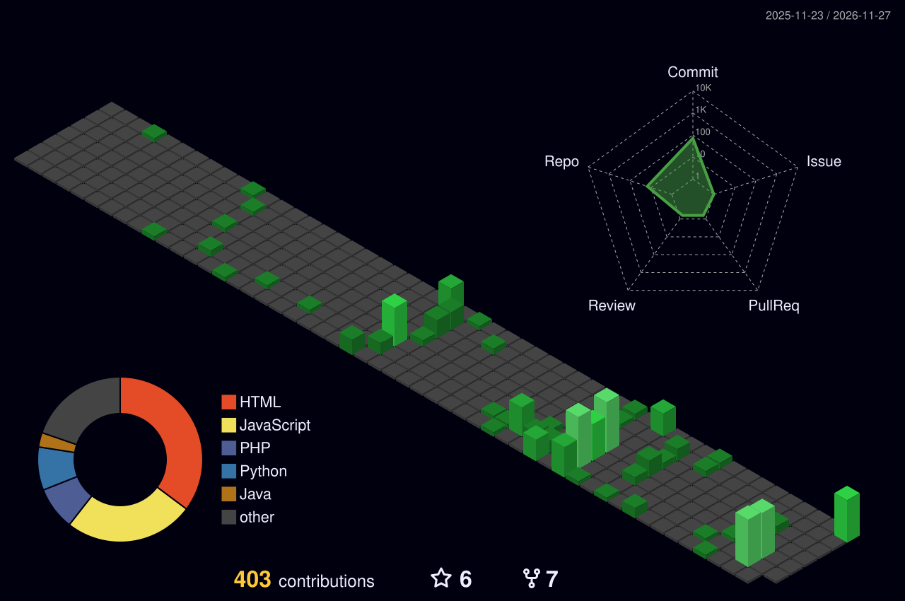

# Abin Shaji Thomas

GitHub profile and selected learning, project, and contact information.

## About

- B.Tech student in Computer Science and Engineering, specializing in Cyber Security
- Interested in cybersecurity, ethical hacking, and software development
- Pronouns: he/him

## Areas of interest

Cybersecurity, Python, Java, C, Bash, web development, networking, and practical security learning.

## Selected links

- [Resume](Resume/Abin_Shaji_Thomas_Resume_18.2.26.pdf)
- [Certifications and badges](https://github.com/Abin-Shaji-Thomas/Certifications-and-Badges)
- [GitHub projects](https://github.com/Abin-Shaji-Thomas?tab=repositories)
- [TryHackMe profile](https://tryhackme.com/p/ABINSHAJI)
- [LinkedIn](https://www.linkedin.com/in/abin-shaji-thomas/)
- [Portfolio](https://abinshajithomas.vercel.app)

## Skills and tools

The profile badges below summarize tools and technologies used during study and project work; they are not a claim of professional certification or mastery.

## Contact

- Email: [abinshaji.me@gmail.com](mailto:abinshaji.me@gmail.com)
- [LinkedIn](https://www.linkedin.com/in/abin-shaji-thomas/)
- [Instagram](https://www.instagram.com/abin_shaji_thomas/)

## Profile activity

